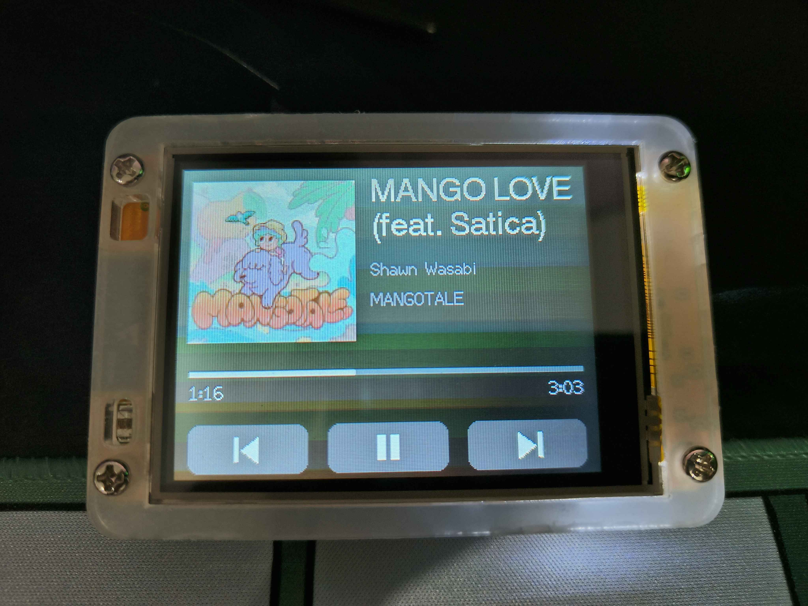
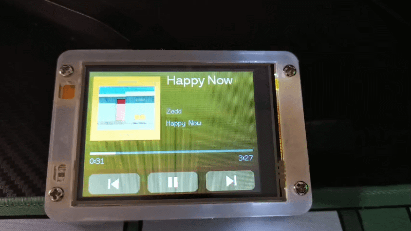
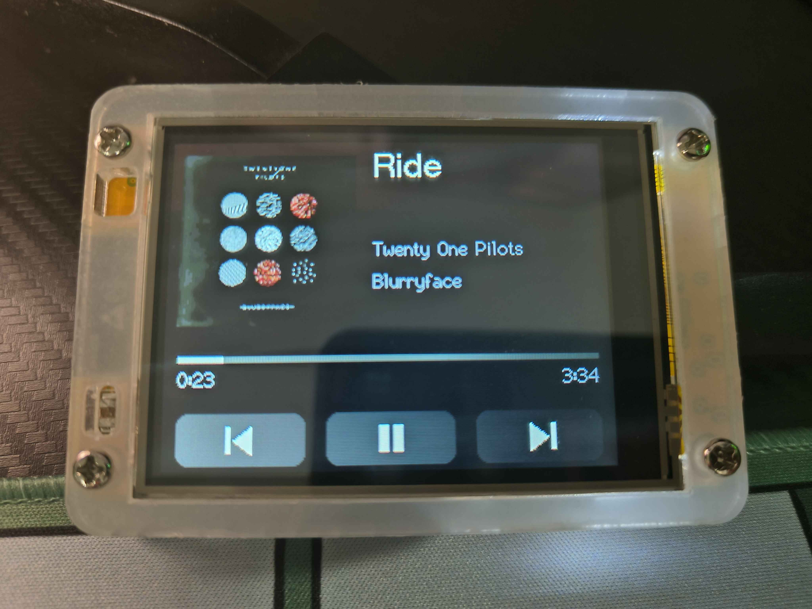
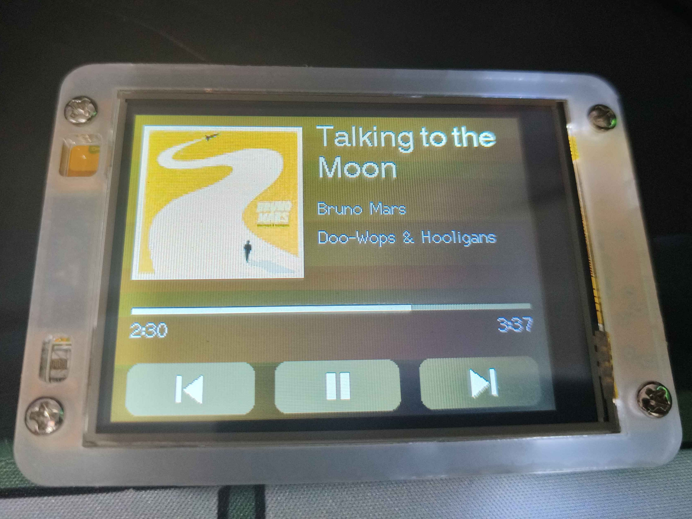
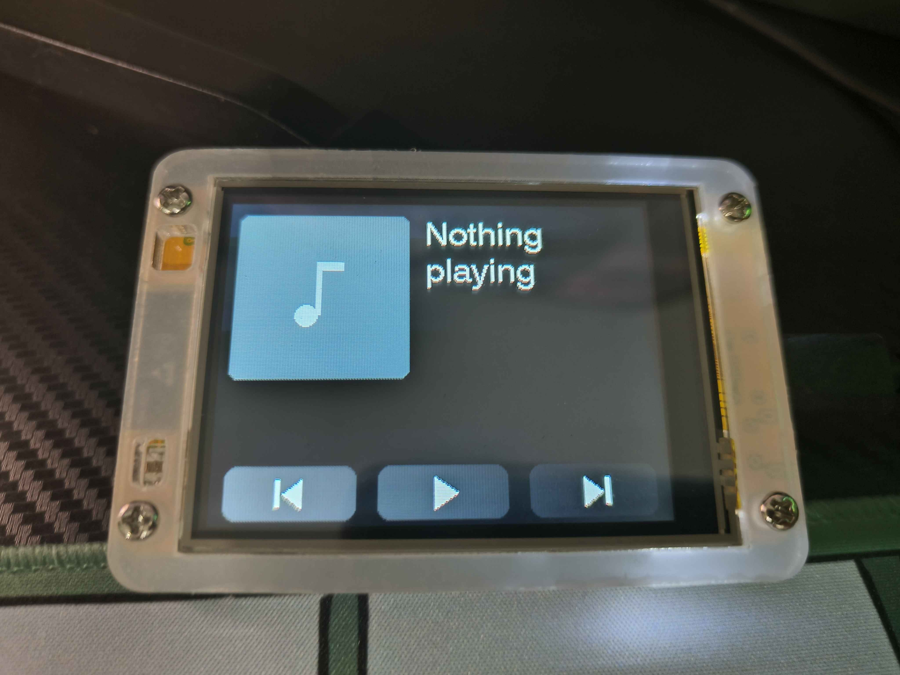
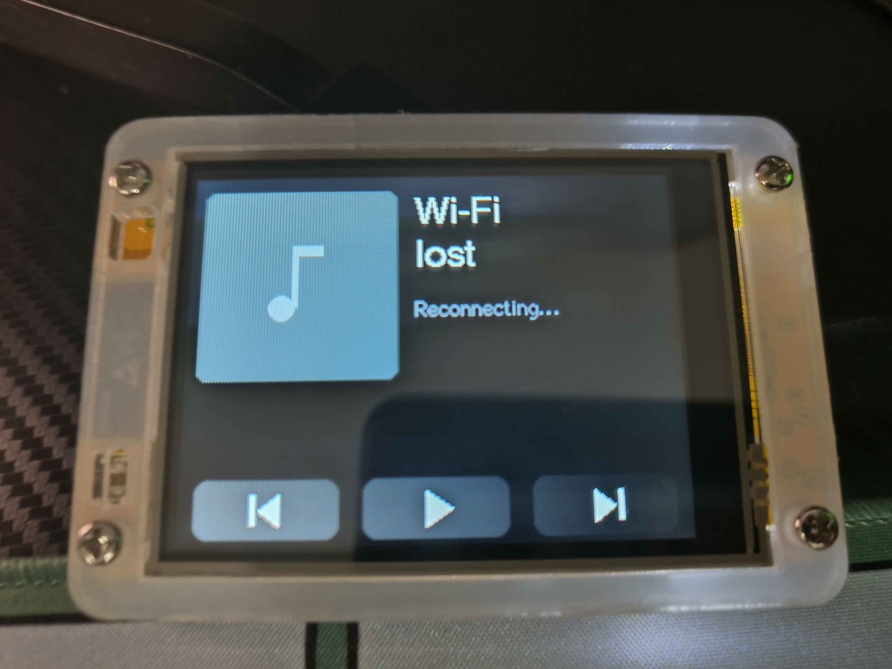
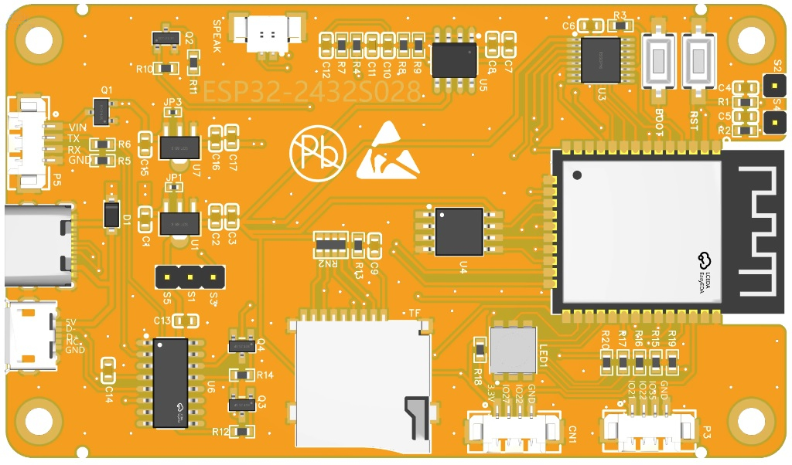
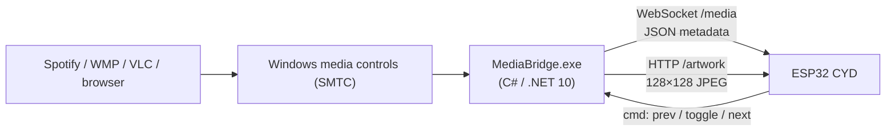

<div align="center">

# ESP32 CYD Media Controller

**A free, no-API "now playing" screen and touch remote for any Windows media app.**
Album art, live progress, album-colour backgrounds, and three touch buttons, on a ~$15 ESP32 touchscreen.


<!-- HERO IMAGE -->


<!-- DEMO GIF: skip a track, show the colour change and the scrolling title -->


</div>

---

## Features

- **Shows what's playing on your PC**: title, artist, album, play state and a smooth progress bar with elapsed and total time.
- **Album artwork** (128×128), fetched in about 40–70 ms and decoded in about 30–50 ms on my setup.
- **Album-colour gradient background**: the colours are taken from each cover, then darkened hard so text always stays readable, even with a bright cover.
- **Touch remote**: previous, play/pause and next control the same app that's shown on screen.
- **Scrolling titles**: titles that fit in two lines wrap; longer ones scroll smoothly.
- **Smart backlight**: dims after 30 s of not playing; **one touch wakes it and presses the button underneath**, with no wake-up tap.
- **Self-healing**: separate "Wi-Fi lost" and "Bridge offline" screens, automatic reconnects, and a low-heap watchdog.
- **Works with anything that uses Windows media controls**: Spotify desktop, Windows Media Player, VLC, and browsers that integrate with Windows media controls.
- **No Spotify Premium, no developer account, no OAuth, no tokens, no cloud.** Everything stays on your local network.

## Example Showcase

<table>
  <tr>
    <th colspan="3">Playing</th>
  </tr>
  <tr>
    <td align="center"></td>
    <td align="center"></td>
    <td align="center"></td>
  </tr>
  <tr>
    <td colspan="3" align="center">Title, artist, album, progress</td>
  </tr>
</table>

<table>
  <tr>
    <th colspan="3">Device States</th>
  </tr>
  <tr>
    <td align="center"></td>
    <td align="center"></td>
    <td align="center"></td>
  </tr>
  <tr>
    <td align="center">Nothing playing</td>
    <td align="center">Retries every 10 s</td>
    <td align="center">ESP32-2432S028</td>
  </tr>
</table>


## System Architecture



1. **MediaBridge** (Windows) reads the active media session through `GlobalSystemMediaTransportControlsSessionManager`, and polls it every 500 ms.
2. It pushes the full state over a **WebSocket** to every connected client on each change, plus a 5 s heartbeat. Cover art is resized to 128×128 as a baseline JPEG, and two average colours (top half and bottom half) are sent with it.
3. The **ESP32** draws the UI, advances the progress bar locally between messages, and only redraws what changed.
4. Touch presses are sent back as `{"cmd":"next"}` and so on. The bridge runs them on the **same session** it's displaying, so the screen and the buttons always agree.

There is deliberately **no Bluetooth**: the Wi-Fi link already carries everything, which avoids pairing problems and keeps the ESP32's RAM free.

## Hardware

| Part | Notes |
|---|---|
| **ESP32-2432S028 "CYD"** | ESP32-D0WD-V3, 2.8" 320×240, ILI9341, resistive XPT2046 touch. This is the board the project was built and tested on. |
| USB cable | Must carry data (for flashing) |
| A Windows 10/11 PC | Runs the bridge |

> Other CYD variants may need a different display driver or pins. See [Troubleshooting](#-troubleshooting).

### Verified pin map (ESP32-2432S028)

| Function | GPIO |
|---|---|
| **Display** MISO / MOSI / SCLK | 12 / 13 / 14 |
| Display CS / DC / RST | 15 / 2 / -1 (not connected) |
| Display backlight (PWM, 5 kHz, 8-bit) | 21 |
| **Touch** CLK / MISO / MOSI | 25 / 39 / 32 |
| Touch CS / IRQ | 33 / 36 |

The display is on the HSPI bus and the touch controller on its own separate bus. The SD slot, RGB LED, light sensor and speaker aren't used.

**Display settings:** `ILI9341_2` driver, colour inversion off, `setRotation(1)` (landscape, 320×240).
**Touch calibration:** raw X 360–3680, raw Y 370–3800, `setRotation(1)`.

## Installation Guide

### Requirements

| Software | Version |
|---|---|
| Windows | 10 or 11 |
| .NET SDK | 10 (to build the bridge) |
| Arduino IDE | 2.x |
| ESP32 board package (Espressif) | **2.0.17**. Don't use 3.x; the PWM code uses the 2.x API. |
| TFT_eSPI (Bodmer) | 2.5.43 |
| XPT2046_Touchscreen (Paul Stoffregen) | latest |
| TJpg_Decoder (Bodmer) | 1.1.0 |
| WebSockets (Markus Sattler) | 2.7.2 |
| ArduinoJson (Benoit Blanchon) | **7.x** (the code uses the v7 API) |

### 1. Bridge (Windows)

**Run it while developing:**
```
cd media-bridge
dotnet run
```

**Build a hidden `.exe` that starts with Windows:**
```
cd media-bridge
dotnet publish -c Release -r win-x64 --self-contained false -p:PublishSingleFile=true -p:OutputType=WinExe -o ..\dist\MediaBridge
```
1. Copy `dist\MediaBridge\` to a permanent place such as `C:\Tools\MediaBridge\`.
2. Press **Win+R**, run `shell:startup`, and add a shortcut to `MediaBridge.exe`.
3. Allow it through the firewall (admin PowerShell, one time):
   ```
   netsh advfirewall firewall add rule name="MediaBridge" dir=in action=allow protocol=TCP localport=8080 profile=private
   ```
4. Your Wi-Fi network must be set to **Private** in Windows settings.
5. Stop it from Task Manager, or `taskkill /im MediaBridge.exe /f`.

> Don't run the bridge as a Windows Service. Services can't see your user's media sessions, so it must run in your login session.

**Reserve your PC's IP** in your router (DHCP reservation) so the address in `config.h` never changes. Find it with `ipconfig`.

**Check it works** from a browser (or your phone, on the same Wi-Fi):
- `http://<pc-ip>:8080/now-playing`: JSON
- `http://<pc-ip>:8080/artwork`: the current cover

### 2. Firmware (ESP32)

1. **Install** the Arduino IDE, add the ESP32 board URL
   `https://raw.githubusercontent.com/espressif/arduino-esp32/gh-pages/package_esp32_index.json`
   in *Preferences*, and install **esp32 by Espressif Systems 2.0.17**.
2. **Install the libraries** from the table above.
3. **Display driver config:** copy `cyd-media-controller/TFT_eSPI_User_Setup.h` over
   `Documents\Arduino\libraries\TFT_eSPI\User_Setup.h` (back up the original first).
4. **Credentials:** copy `cyd-media-controller/config.example.h` to `config.h` in the same folder and fill in:
   ```cpp
   #define WIFI_SSID   "your 2.4 GHz network"
   #define WIFI_PASS   "your password"
   #define BRIDGE_IP   "192.168.1.x"     // your PC
   ```
5. **Board settings:** *ESP32 Dev Module*, Upload Speed 460800 (use 115200 if uploads fail), default partition scheme.
6. Open `cyd-media-controller/cyd-media-controller.ino` and **Upload**. If it hangs on "Connecting...", hold **BOOT** until it starts writing.
7. Open the Serial Monitor at **115200** baud to see status lines.

## Usage Instructions

| Action | Result |
|---|---|
| Tap ⏮ / ⏯ / ⏭ | Previous / play-pause / next in the app shown on screen |
| Touch while dimmed | Wakes the screen **and** presses that button |
| Pause or stop for 30 s | Backlight fades to ~10% |
| Play, change track or change state | Wakes to full brightness |

Which app is shown follows Windows' own "current session". If you have several media apps open, Windows picks which one is current.


### Screens

| Screen | When |
|---|---|
| Now playing | Bridge connected, something loaded |
| Nothing playing | Bridge connected, no media session |
| Bridge offline | Wi-Fi is up but the bridge isn't reachable |
| Wi-Fi lost | Wi-Fi is down. It retries every 10 s and restarts the board after 5 minutes. |

### Tunables (top of `cyd-media-controller.ino`)

| Setting | Default | Meaning |
|---|---|---|
| `BL_DIM` | 25 | Dimmed brightness, 0–255 |
| `DIM_AFTER_MS` | 30000 | Time before dimming |
| `SCROLL_STEP_MS` / `SCROLL_PX` | 40 / 2 | Scroll speed |
| `SCROLL_HOLD_MS` | 1500 | Pause before each scroll |
| `WIFI_RETRY_MS` | 10000 | Wi-Fi retry interval |
| `WIFI_RESTART_MS` | 300000 | Restart if Wi-Fi is down this long |
| `HEAP_RESTART_BELOW` | 60000 | Restart if free heap stays under this (bytes) |

Background darkness is set by the `darkenColour(...)` calls in `handleMessage` (top: brightness scale 0.55, clamped to 0.10–0.30; bottom: 0.30, clamped to 0.03–0.16).

## Bridge API

| Endpoint | Description |
|---|---|
| `GET /now-playing` | Current state as JSON |
| `GET /artwork` | Current cover, 128×128 baseline JPEG (404 if none) |
| `WS /media` | Pushes the JSON on connect, on every change, and every 5 s |
| `WS /media` (client → bridge) | `{"cmd":"prev"}`, `{"cmd":"toggle"}`, `{"cmd":"next"}` |

```json
{
  "title": "Example Song",
  "artist": "Example Artist",
  "album": "Example Album",
  "state": "playing",
  "position_ms": 84200,
  "duration_ms": 213000,
  "art_url": "http://192.168.1.7:8080/artwork?v=3",
  "updated_at": 1730000000000,
  "app": "Spotify.exe",
  "art_colors": [120, 60, 40, 30, 20, 50]
}
```

`art_colors` is the average colour of the top and bottom halves of the cover (`r,g,b,r,g,b`). `art_url` is `null` when there's no artwork.

## Tests

The `tests/` folder holds the standalone sketches used to bring the project up one subsystem at a time. They're useful if you have a different CYD variant or something stops working.

| Sketch | Verifies |
|---|---|
| `cyd_display_test` | Display driver, colours, orientation, backlight |
| `cyd_touch_test` | Touch pins, calibration, button hit areas |
| `cyd_ws_test` | Wi-Fi, WebSocket, auto-reconnect, heap |
| `cyd_jpeg_test` | HTTP artwork fetch, JPEG decode, redraw skipping |
| `cyd_cmd_test` | Touch buttons controlling media over WebSocket |

Each sketch folder needs a `config.h`; copy `cyd-media-controller/config.example.h` into it.

## Troubleshooting

| Problem | Fix |
|---|---|
| No COM port appears | Charge-only cable, or missing CH340 driver |
| Upload hangs on "Connecting..." | Hold **BOOT** while it starts; try upload speed 115200 |
| White or garbled screen | Wrong display driver. This board needs `ILI9341_2` (`CYD_DRIVER 1` in the test setup) |
| Colours inverted (black looks white) | Set `CYD_INVERT` to 1 |
| Red and blue swapped | Add `#define TFT_RGB_ORDER TFT_BGR` to `User_Setup.h` |
| Backlight stays off | Some CYDs use GPIO 27 for the backlight instead of 21 |
| Touch is mirrored | Swap the min/max values of the mirrored axis |
| "Wi-Fi timeout" at boot | Wrong password, or the network is 5 GHz-only. Use a 2.4 GHz SSID |
| Screen says "Bridge offline" | Bridge not running, PC IP changed, firewall blocking, or the network is set to Public |
| Works on `localhost`, not from another device | Open the firewall rule above and set the network to **Private** |
| "Address already in use" | Another copy of the bridge (or another app) is using port 8080 |
| Grey placeholder instead of art | The app has no art, or the bridge isn't producing 128×128. Check `/artwork` |
| Art colours look wrong | Flip `TJpgDec.setSwapBytes(true)` to `false` |
| Nothing detected from a media app | That app doesn't use Windows media controls (some browsers need media-key integration on) |
| Wrong app on screen | Windows chooses the current session. Pause or close the others |
| A button does nothing | The app rejected the command; the bridge console shows "rejected by app" |
| Accented or non-Latin text shows as `?` | Built-in fonts are ASCII only |
| Whine from the screen when dimmed | In `ledcSetup(0, 5000, 8)`, raise 5000 to 20000 |
| Compile error `JsonDocument` not found | You have ArduinoJson 6; install 7.x |
| Compile error on `WebSocketsClient.h` | Wrong library; it must be the one by Markus Sattler |
| Board reboots occasionally | Check Serial for `[heap] critically low` or `[wifi] down too long` |
| Bridge IP keeps changing | Make a DHCP reservation in your router |

## Limitations and security

- **Windows only** for the bridge, and one PC per display.
- **Accents and non-Latin text** appear as `?`.
- **There is no authentication.** The bridge listens on your whole local network on port 8080. Anyone on that network can read what you're playing and send previous, play/pause and next. Use it only on a network you trust, and never forward the port to the internet.
- The 2.4 GHz band only, as on all ESP32s.

## Credits

Built with [TFT_eSPI](https://github.com/Bodmer/TFT_eSPI), [TJpg_Decoder](https://github.com/Bodmer/TJpg_Decoder), [arduinoWebSockets](https://github.com/Links2004/arduinoWebSockets), [ArduinoJson](https://arduinojson.org/) and [XPT2046_Touchscreen](https://github.com/PaulStoffregen/XPT2046_Touchscreen), and on the Windows `GlobalSystemMediaTransportControlsSessionManager` API.

## License

MIT License (as described in `LICENSE` in the repo root).